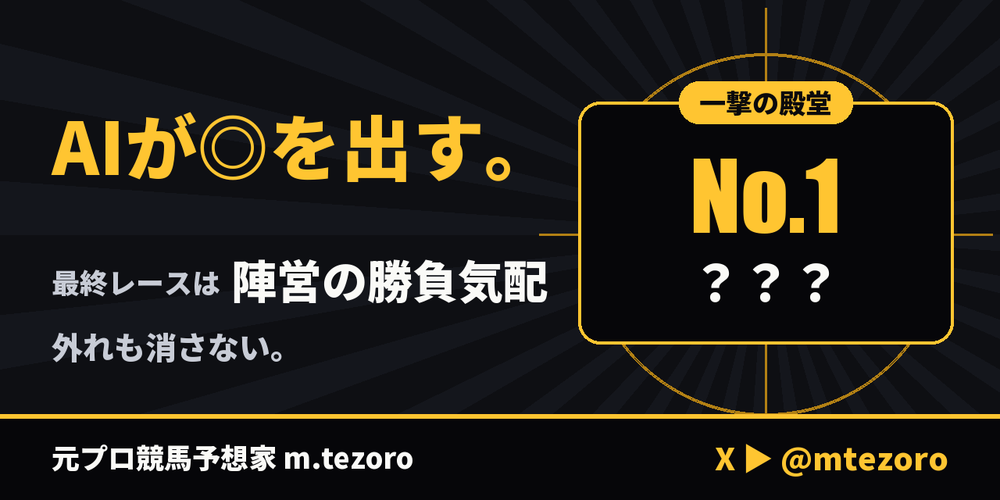

# 元プロ競馬予想家 m.tezoro｜AIの◎と陣営の勝負気配

**元プロの俺が、自分で育てたAIを走らせる。**  
土日のAIの印は、前の晩21時から記事で（各場の1Rは無料）。  
重賞の日は朝10時に元プロの勝負馬券を先に出し、AIの記事の印と **AI vs 元プロ**🥊  
開催日は、最終レースに元プロの◎○▲△と陣営の勝負気配🐎  
X ▶ [@mtezoro](https://x.com/mtezoro)

## 約束

- 予想と結果は全部記録する
- 外れも消さない

## ⏰ AIの◎

全部の◎は発走の後に、前の晩と朝9時の印は `ai_marks.csv`、直前の◎は `m1_picks.csv` へ。結果は `ai_marks_results.csv` と `m1_results.csv` へ。10/10 から、レースごとに「○戦○勝」で数えます。
投稿は印 ◎○▲△ だけ。買い方は決まった7つから選べます：三連単マルチ ◎軸○▲△・三連単 ◎→○▲→○▲△・三連複 ◎-○▲△・馬単 ◎→○▲△・馬連 ◎-○▲△・ワイド ◎-○▲△・単勝 ◎。
`bets.csv` に記録し、当たったらすぐ速報🎯。回収率は1か月以上でプラスの買い方だけ。
有料の記事（BOOKERS・1レース1本）の番号は、前の晩の記事は `kiji.csv`、直前の記事は `bookers.csv` に残します（2026年10月17日の開催の分から）。

## 🥊 重賞の札（AI vs 元プロ）

元プロの勝負馬券は重賞の日の朝10時に先に出して `pro_picks.csv` へ。発走5分前の札でも同じ券で勝負します。
勝ち負けと通算の星取りは `vs.csv`、元プロの結果は `pro_results.csv` に残します。

## 🐎 陣営の1行

重賞の元プロの札と最終レースに、一流の陣営のしるしが出たら「🐎陣営：」の1行（印の馬から2頭まで）。今季の一流（調教師10人・騎手10人）は [`今季の一流.csv`](今季の一流.csv)。

## 💥 一撃の殿堂

発走前に記事で出したAIの◎が勝って、単勝の払戻が1,000円以上で殿堂入り。番号を付けて `ichigeki.csv` へ。

## 🐣 明日の新馬（POG）

新馬戦の前の夜に、翌日デビューの全頭の順位を `pog_picks.csv` に記録します。

## 📖 はじまりの話

10/4、AIは京都大賞典の ◎12 エコロディノスを選んで1着（単勝2,900円）。  
10/10 から、AIの◎は全部記録します。

---
決まりとファイルの説明は [決まり.md](決まり.md)
